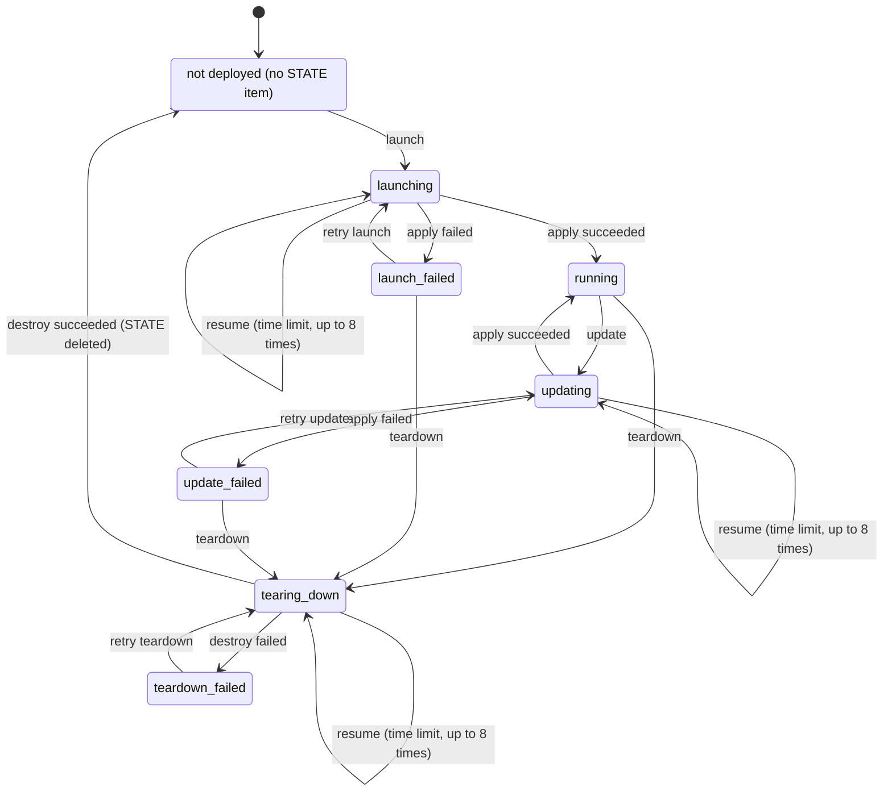

# Launchpad design

Implements [001_overview.md](001_overview.md). This is the contract the
segments of the build follow.

## Decisions that interpret the overview

| Topic | Decision | Why |
|---|---|---|
| Deployment tool | Terraform. The CloudFormation wording in the overview (lines 8-10) is superseded by lines 20-22. | The later lines are specific and the PIMS demo is Terraform. |
| Where demos live | `DemosPath` stack parameter, default `demos`. A demo is a direct sub directory that has a `tf/` directory. | PIMS lives in `demos/pims`. Set `DemosPath=launchpad-demos` to follow the overview literally. |
| One instance per demo | A demo has one deployment. | Terraform state is per demo, not per user. |
| Who signs in | One person, the owner (`SuperUserEmail`). The overview's registration and review list are not built. | The code goes to one phone number, so only its holder can sign in. |
| Sign in | The owner types their phone number. If it matches the number in a Secrets Manager secret, a one-time code is texted to it through SNS. The page is always told that a code was sent. | SES mail from a `confluent.io` address was dropped by the recipient's DMARC policy, `p=reject`. The overview's emailed OTP and `@confluent.io` registration are superseded. |
| Credentials store | KMS encrypted blob in DynamoDB. | The overview says DynamoDB for storage. KMS keeps the secret off the page and out of backups in plain text. |
| Language | Go, on the `provided.al2023` runtime (x86_64), as three programs: `api`, `runner` and `sitedeployer`. | The overview says the functions are written in Python. That was changed on request. One static binary per function starts fast, and the runner needs no interpreter next to Terraform. |
| Terraform compute | Lambda, container-less. The binary is downloaded to `/tmp`, checksum pinned. A run that hits the Lambda time limit is interrupted and resumed by a new invocation. | The overview says Lambda for compute. Terraform is idempotent, so resuming is safe. |
| Updating a demo | A running demo is updated in place, with a new `terraform apply` of the commit that is now at the tip of `DemosRepoRef`. It is not torn down first. | Destroying and launching again loses whatever the demo holds that is not in its Terraform, and takes much longer. Terraform's own plan already works out what to change. |
| Front end hosting | S3 + CloudFront. `/api/*` goes to an HTTP API. | Serverless, one origin, so no CORS. |

## Architecture

```
Browser ── CloudFront ──┬── S3 (React build)
                        └── /api/* ── HTTP API ── Lambda api ──┬── DynamoDB (single table)
                                                               ├── SNS (OTP text) + Secrets Manager (the number)
                                                               ├── KMS (credentials)
                                                               └── async invoke ── Lambda runner
                                                                                     ├── GitHub (demo source, read only)
                                                                                     ├── S3 (terraform state)
                                                                                     └── terraform → the demo's resources
```

Everything Launchpad creates carries the tag `launchpad:managed=true`.
Everything a demo creates carries `launchpad:managed=true` and
`launchpad:demo=<id>`.

## Code

One Go module in `backend/`. A program in `cmd/` only reads its environment and
hands events to a package in `internal/`.

| Program | Package | Does |
|---|---|---|
| `cmd/api` | `api` | HTTP API behind API Gateway: routing, sessions, JSON |
| `cmd/runner` | `runner` | Applies or destroys one demo, in slices of at most one invocation |
| `cmd/sitedeployer` | `site` | The `SiteContent` custom resource: copies the React build to the site bucket and empties the bucket on delete |

The rest of `internal/` is what they share: `auth`, `sms`, `users`,
`credentials`, `catalog`, `runs`, `github`, `source`, `terraform`, `demoif`
(the demo interface check), `db`, `metrics` and `config`. `services` holds the
AWS clients and settings, each behind a small interface so tests can replace it.

`db` takes conditions and updates as Go values (`db.Equal`, `db.OneOf`, the
`Add` of a `db.Update`) rather than expression strings. `db.Dynamo` turns them into DynamoDB
expressions and `db.Memory` evaluates them directly, so the logic that depends
on conditional writes (one run at a time, the 5 guesses of a code) is tested
without a database. The tests of `db`, and every other package's tests, also run
against a real DynamoDB when `LAUNCHPAD_DYNAMODB_ENDPOINT` names one, for example
DynamoDB Local. That is what keeps `db.Memory` honest.

## DynamoDB (single table `pk`/`sk`)

| pk | sk | Attributes |
|---|---|---|
| `USER#<email>` | `PROFILE` | `role` (`admin`), `createdAt`. Only the owner has one |
| `USER#<email>` | `CREDS` | `ciphertext` (KMS), `apiKeyHint` (last 4), `updatedAt` |
| `OTP#owner` | `OTP` | `salt`, `hash`, `attempts`, `sentAt`, `hourStart`, `hourCount`, `ttl` |
| `SESSION#<sha256 token>` | `SESSION` | `email`, `ttl` |
| `CATALOG` | `DEMO#<id>` | `name`, `description`, `path`, `ref`, `version`, `latest`, `needsConfluent` |
| `CATALOG` | `META` | `refreshedAt`, `ref` |
| `DEMO#<id>` | `STATE` | `status`, `runId`, `ref`, `version`, `launchedBy`, `credsOwner`, `url`, `error`, `logTail`, `resumes`, `updatedAt` |

Time to live (`ttl`) is enabled on the table, so OTPs and sessions expire.
Reads of an expired item must still check `ttl` because deletion is lazy.

## Sign in

1. `POST /api/auth/start {phone}`: the page asks for the owner's phone number.
   The number is normalised (spaces, dashes, dots and brackets dropped) and must
   be E.164, or the answer is `400 invalid_number`. That check looks only at the
   input. The API then reads the number from the secret `SIGN_IN_SECRET` (E.164,
   as a plain string or a one-entry JSON object) and compares it in constant
   time. Only on a match does it make a 6 digit OTP and publish it to the
   secret's number with SNS, as a transactional message. **The answer is always
   `202 {sent: true}`**, so it cannot be used to find the number. A wrong number,
   a limit (30 s between sends, 10 per hour), a secret that is not set up, a
   failed send and a crash all end the same way. The reason is logged and counted
   in `SignInNotSent{reason}`. The number is never logged.
2. `POST /api/auth/verify {otp}`: the OTP is valid for 10 minutes and 5
   guesses. Stored as `HMAC-SHA256(salt, otp)`, compared in constant time.
   On success the owner's profile is created if it is missing (`admin`) and a
   session is created for `SuperUserEmail`.
3. The session is an opaque 32 byte token in an `HttpOnly; Secure;
   SameSite=Strict` cookie. Only its hash is stored. Mutating calls also
   require the `X-Launchpad: 1` header.

## HTTP API

| Method and path | Who | Does |
|---|---|---|
| `POST /api/auth/start`, `/api/auth/verify`, `/api/auth/logout` | anyone | sign in |
| `GET /api/me` | session | the user, and whether credentials are saved |
| `GET/PUT/DELETE /api/credentials` | session | Confluent Cloud key. `GET` never returns the secret |
| `GET /api/demos` | session | catalog merged with each demo's state |
| `POST /api/demos/refresh` | admin | re-read the repository now |
| `GET /api/demos/{id}` | session | one demo with its log tail |
| `POST /api/demos/{id}/launch` | session | start `terraform apply` |
| `POST /api/demos/{id}/update` | launcher or admin | re-read the repository, then start `terraform apply` of the new commit on a running demo |
| `POST /api/demos/{id}/teardown` | launcher or admin | start `terraform destroy` |

Each demo in `GET /api/demos` and `GET /api/demos/{id}` has a `state` that, besides
the stored fields, says `canUpdate` (the user may update it, as for teardown) and
`updateAvailable` (the demo is `running`, follows the interface, and its `version`
is behind the catalog's), which is what the page uses to offer an update.

## Demo lifecycle

A demo is deployed at most once at a time. Its deployment is the `DEMO#<id>` /
`STATE` item, and `status` says where it is in the lifecycle:



| Status | Meaning | What the user can do |
|---|---|---|
| absent | Nothing is deployed. The demo is in the catalog only | Launch |
| `launching` | A runner is applying Terraform | Wait. The page shows the log tail |
| `running` | Applied. `url` holds `launchpad_url` | Open it, or tear down |
| `launch_failed` | The apply failed or could not start. `error` says why | Retry the launch, or tear down what was partly created |
| `updating` | A runner is applying a newer commit to a demo that was running. `url` still holds the old address | Wait. The page shows the log tail |
| `update_failed` | The apply of the newer commit failed or could not start. `error` says why. The demo is partly updated and may not work | Retry the update, or tear down |
| `tearing_down` | A runner is destroying | Wait |
| `teardown_failed` | The destroy failed. Resources may remain | Retry the teardown |

### Launch

1. `POST /api/demos/{id}/launch` reads the demo from the cached catalog. It
   refuses a demo that does not follow the interface (`invalid_demo`) and, for a
   demo that needs Confluent Cloud, a user with no saved key
   (`credentials_required`).
2. It writes the `STATE` item with `status=launching`, a fresh `runId`, and
   `ref` and `path` copied from the catalog entry. The write succeeds only if
   the item is absent or `launch_failed`, otherwise the answer is `409
   not_launchable`.
3. It starts the runner asynchronously. If the runner cannot be started the item
   goes straight to `launch_failed` and the answer is `502 runner_unavailable`.
4. The runner applies the demo (see [Runner](#runner)). It ends the run with
   `running` and the `launchpad_url`, or with `launch_failed` and an error.

### Retry a failed launch

A retry is a new launch, not a continuation. It starts again from step 1, with a
new `runId`, `resumes` back at 0 and the error cleared. Terraform state is kept in
S3, so the apply carries on from what the failed run created.

Each catalog entry also carries `latest`: whether its `ref` was the tip of `main`
when the repository was last read. The demo list shows the short `ref` and this
flag, so it can be up to `CacheSeconds` out of date. When `DemosRepoRef` is not
`main`, a refresh makes one more call to resolve `main`; if that fails, `latest`
is false and the refresh still succeeds.

A retry runs the commit `ref` of the **cached** catalog entry, not the tip of
`DemosRepoRef`. The cache is re-read when a demo listing finds it older than 10
minutes (`CacheSeconds`) or when an admin calls `POST /api/demos/refresh`. The
launch call itself never refreshes it. To run a fix just pushed to GitHub, refresh
the catalog and then retry. The `ref` is fixed for the whole run, including its
resumed slices, so one run never changes version part way through.

### Update

A demo is updated when anything in its directory has changed in the repository
after it was launched. The repository is shared by every demo, so its commit
`ref` changes with every push and says nothing about one demo. Each catalog entry
therefore also has a `version`, Git's id of the demo's directory at that `ref`
(from the tree listing the refresh already reads), which changes when, and only
when, something at or below the directory does. The `STATE` item keeps the
`ref` and `version` that were applied. When the `version` of the catalog entry
differs from the state's, the page says an update is available. A state or
catalog entry without a `version`, from before versions were kept, is compared by
`ref` instead. A demo that is deployed stays on the version it was launched or
last updated at until somebody asks for an update.

1. `POST /api/demos/{id}/update` needs the person who launched the demo, or the
   admin, as teardown does (otherwise `403`). It answers `404` when the demo is not
   deployed, and `409 not_updatable` unless it is `running` or `update_failed`.
2. It first re-reads the repository, as `POST /api/demos/refresh` does, so a
   commit pushed a moment ago is found without waiting for `CacheSeconds`. If
   the repository cannot be read the answer is `502 catalog_unavailable` and the
   demo is untouched. The launch call does not do this, and still uses the
   cached catalog.
3. It refuses a demo that is no longer in the repository (`409 demo_removed`:
   tear it down) and one that no longer follows the interface (`invalid_demo`). It
   refuses a `running` demo whose `version` is already the new one (`409
   up_to_date`), so a click that has nothing to apply does not start a run. An
   `update_failed` demo can always be retried, even at the same `ref`.
4. A demo that needs Confluent Cloud, at the old commit or the new one, is
   applied with the key of the person who launched it, and with no one else's:
   an update creates and changes things, and another person's key would be
   pointed at resources in an account that is not theirs. If the launcher has no
   saved key the answer is `409 credentials_required`, and the launcher saves
   one and tries again. (A teardown, which only deletes, also accepts the key of
   whoever asks, so that a demo can always be removed.) A `credsOwner` already
   recorded is not enough: the key may have been deleted since. An admin who
   updates another person's demo therefore spends that person's saved key, as
   a teardown does.
5. It sets `status=updating` with a fresh `runId`, and copies `ref`, `version`
   and `path` from the new catalog entry. `needsConfluent` becomes true if the old
   code or the new code needs a key, and stays true after that. `launchedBy` and `url` are left as
   they are, and `error` and the log are cleared. The write succeeds only from
   `running` or `update_failed`, otherwise the answer is `409 not_updatable`.
6. The runner applies the new commit (see [Runner](#runner)). The outcome is
   `running` with the `launchpad_url` the demo now prints, or `update_failed`
   with an error. A failed update keeps the old `url`, since the demo is
   probably still there. The shutdown hook is **not** called: it is for
   destroying.

Retrying a failed update is a new update, so it uses the commit at the tip of
`DemosRepoRef` at that time, which may be newer than the one that failed. As with
a retry of a failed launch, Terraform state is in S3 and the apply carries on from
there. A teardown after a failed update destroys with the `ref` of the update,
the last code that was applied, in whole or in part.

Terraform decides what an update does, so a demo author makes the change safe:
a change to a resource that cannot be changed in place makes Terraform destroy
and create it. Check `terraform plan` for such changes before merging a change
to a demo that people have running.

### Teardown

1. `POST /api/demos/{id}/teardown` needs the person who launched the demo, or the
   admin. It is allowed from `running`, `launch_failed`, `update_failed` and
   `teardown_failed` (otherwise `409 not_tearable`).
2. It sets `status=tearing_down` with a fresh `runId`. The `ref` is **not**
   changed, so the destroy uses the code that was last applied. A demo that needs
   Confluent Cloud is destroyed with the key of the person who launched it, or
   else the key of the person tearing it down.
3. Before it destroys anything, the runner asks a demo that wants it to shut
   itself down (see [Shutdown hook](#shutdown-hook)).
4. On success the runner deletes the `STATE` item and the demo is not deployed
   again. On failure the status is `teardown_failed`.

### State machine

Transitions are conditional writes, so two clicks cannot start two runs:

* launch: from absent or `launch_failed` to `launching`
* update: from `running` or `update_failed` to `updating`
* teardown: from `running`, `launch_failed`, `update_failed` or
  `teardown_failed` to `tearing_down`
* the runner moves `launching` to `running` or `launch_failed`, `updating` to
  `running` or `update_failed`, and `tearing_down` to absent or `teardown_failed`

`runId` is a fresh id per request. A runner whose `runId` no longer matches
the item exits, so a stale invocation never changes a newer run.

## Runner

1. Load the `STATE` item and check `runId`.
2. Download Terraform (once per container) and verify its SHA-256.
3. Download the demo source at the `ref` recorded when the run was requested (the
   commit SHA of `DemosRepoRef` at that time), so teardown uses the code that was
   applied. A launch, a retry and an update each record a new one.
4. Check the interface below, write the backend file, `terraform init`.
5. For a teardown that is not a resumed slice, call the demo's shutdown hook
   if it has one. Then `apply -auto-approve` or `destroy -auto-approve`, with a deadline. At the
   deadline Terraform gets SIGINT and 90 s to stop. If it has not finished
   the runner re-invokes itself with `resumes + 1`, up to 8 times.
6. After an interrupted run the state lock may be stale. The runner clears it
   with `force-unlock`, which is safe because the `runId` proves no other run
   of this demo is active.
7. On success `launchpad_url` is read with `terraform output`.

Secrets reach Terraform only as process environment (`TF_VAR_*`, and
`CONFLUENT_CLOUD_API_KEY`/`_SECRET`). The log tail is scrubbed of them.

## Demo interface

A demo directory has `tf/` and may have `demo.json` with `name` and
`description`. Launchpad passes (as `TF_VAR_*`):

| Variable | Type | Required | Value |
|---|---|---|---|
| `aws_region` | string | yes | the region Launchpad is deployed in |
| `launchpad_tags` | map(string) | yes | apply to every resource that takes tags, for example as provider `default_tags` |
| `launchpad_demo_id` | string | no | the directory name |
| `confluent_cloud_api_key`, `confluent_cloud_api_secret` | string, sensitive | no | the launching user's saved key. A demo that declares them needs one |

The demo must declare the output `launchpad_url` (string, the URL the user
opens, empty if there is none), and may declare `launchpad_shutdown` (see
[Shutdown hook](#shutdown-hook)). It must not declare a `backend`: Launchpad
supplies an S3 backend at `demos/<id>/terraform.tfstate`.

### Shutdown hook

A demo can have things outside its Terraform that must be undone before Terraform
can delete what it made. PIMS, for one, switches Tableflow on for the topics
that Terraform owns, and Terraform cannot delete a topic that has it. Such a demo
declares the optional output `launchpad_shutdown`, a sensitive JSON string:

```json
{"url": "https://<demo>/shutdown", "token": "<secret>"}
```

Before `terraform destroy` the runner reads the output (after `init`, from the
state in S3) and sends `POST <url>` with `Authorization: Bearer <token>`. The `url`
must be `https`: the token travels with the request, and a demo whose output says
otherwise is not called. The request has no redirects and 65 seconds.

| The demo answers | The runner |
|---|---|
| any 2xx | destroys |
| 502, 503, 504, or no answer at all, three tries 5 seconds apart | destroys. Nobody is behind the gateway, and a demo that is gone must still be destroyable |
| anything else, such as a 500 with `{"error": "..."}` | does not destroy. The run ends `teardown_failed` with the demo's message, and the person retries the teardown |
| an unusable output | logs why and destroys |

So a demo says "I tried and failed" with a status other than 502, 503 and 504,
and the call must be safe to repeat. A teardown resumed in a later slice does not
ask again. The token is hidden in the run's log and in the error.

## Observability

Both Lambdas emit CloudWatch Embedded Metric Format lines in the `Launchpad`
namespace (`SignInStarted`, `SignInFailed`, `UserRegistered`,
`DemoLaunchRequested`, `DemoLaunchSucceeded`, `DemoLaunchFailed`,
`DemoUpdateRequested`, `DemoUpdateSucceeded`, `DemoUpdateFailed`, `DemoTeardownRequested`, `TerraformSeconds`). The CloudFormation template
creates one dashboard with those, plus Lambda, HTTP API, DynamoDB, SNS text messages and
CloudFront health.

## Build order

1. Backend foundations: config, table access, metrics, tests.
2. Auth and users.
3. Credentials.
4. Catalog and demo source.
5. Runs and the runner.
6. API handler.
7. CloudFormation template and deploy script.
8. React front end.
9. PIMS Launchpad demo (see `demos/pims/docs/specs/launchpad.md`).
