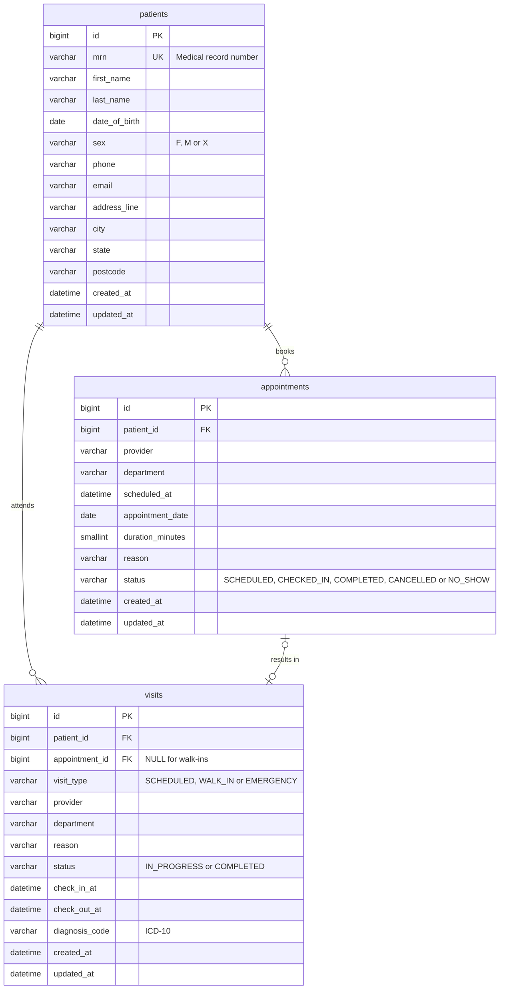
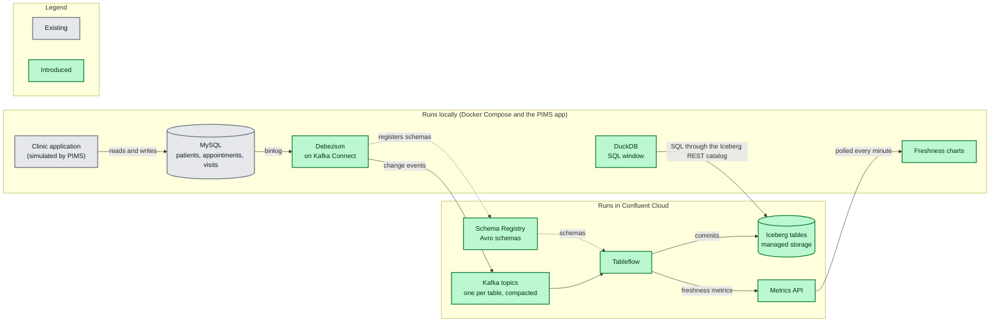

# PIMS

Patient Information Management System: a demo of how a clinic's operational
database can be given a live analytical copy for business reporting, using
Debezium and Confluent Cloud Tableflow.

## Download

| Platform | Download |
|---|---|
| macOS (Apple Silicon and Intel) | [pims_0.4.0_macos_universal.zip](https://github.com/buddhike/bds-cflt-assets/releases/download/pims-v0.4.0/pims_0.4.0_macos_universal.zip) |
| Windows (x64) | [pims_0.4.0_windows_amd64.exe](https://github.com/buddhike/bds-cflt-assets/releases/download/pims-v0.4.0/pims_0.4.0_windows_amd64.exe) |

> [!NOTE]
> **macOS:** the app is not notarized, so macOS blocks a copy downloaded in a
> browser. After unzipping, clear the quarantine flag once from Terminal, in the
> folder that holds `pims.app`, then open the app:
>
> ```sh
> xattr -dr com.apple.quarantine pims.app
> ```

## Run it with Launchpad

Instead of the desktop app, PIMS can run in AWS as a [Launchpad](../launchpad/README.md)
demo. Launch it from Launchpad, which deploys `tf/` with your Confluent Cloud
key, and open the link it shows. The same UI runs in the browser.

One ECS Fargate task runs four containers behind an Application Load Balancer:
the Go server (simulator, UI and API in one binary), MySQL, Kafka Connect with
Debezium, and DuckDB with a small agent that runs the SQL window's queries. How
the parts fit, and the order Terraform and the server set things up in, is in
[docs/specs/launchpad.md](docs/specs/launchpad.md).

* The images are built by `.github/workflows/pims-images.yml` and published to
  `ghcr.io/<owner>/pims-server`, `pims-duckdb` and `pims-connect`. GitHub creates
  packages as private, so make each one public once, or give Terraform a
  registry secret (`registry_credentials_secret_arn`).
* `latest` is published from the default branch. Launchpad passes a demo only
  its standard variables, so `image_tag` is whatever default `tf/variables.tf`
  has. To launch the images of an unmerged branch, set that default to the branch
  name (the workflow tags each push with its branch and commit) on that branch,
  and point the stack's `DemosRef` at it.
* The link is HTTPS, on a `*.cloudfront.net` name, and carries a random access
  token. CloudFront reaches an internal load balancer through a VPC origin. There
  is no IP allow list.
* MySQL's data is on the task's own storage, so it is lost if the task is
  replaced. Tear the demo down from Launchpad, not from the UI.

Before launching, check that the Terraform renders: `cd tf && terraform init
-backend=false && terraform test` uses mock providers and needs no account.

## How the clinic works

PIMS models a busy outpatient clinic with General Practice, Paediatrics,
Cardiology, Dermatology, Orthopaedics and Immunisation departments, plus an
Emergency desk. All patient data is synthetic. A patient moves through the
clinic like this:

1. **Registration.** A new patient is registered at the front desk and is given
   a medical record number (MRN). They can later update their phone number and
   address.
2. **Booking.** The patient books an appointment with a provider in a
   department for a time slot. A patient can hold only one appointment per
   day, and a provider cannot be booked twice for the same slot.
3. **Check-in.** On the day, the patient arrives and checks in. This opens a
   visit linked to their appointment. If they never arrive, the appointment
   becomes a no-show. If they cancel beforehand, it is cancelled.
4. **Visit.** The patient is seen. When the visit finishes, staff record the
   check-out time and a diagnosis code (ICD-10). The visit is completed and so
   is its appointment.
5. **Walk-ins and emergencies.** A patient can also turn up without an
   appointment. They get a visit with no appointment behind it, typed as a
   walk-in, or as an emergency when seen by the Emergency desk.

### How MySQL tracks it

The clinic keeps its records in MySQL, in three tables, one for each thing it
has to remember:

| Table | One row is | How it changes |
|---|---|---|
| `patients` | A registered person, identified by a unique MRN | Inserted at registration. Contact details are overwritten when the patient updates them. |
| `appointments` | A booked slot with a provider, department and time | Inserted as `SCHEDULED`. Its status then moves to `CHECKED_IN` and `COMPLETED`, or to `CANCELLED` or `NO_SHOW`. |
| `visits` | A patient actually attending the clinic | Inserted as `IN_PROGRESS` at check-in. Closed as `COMPLETED` with a check-out time and diagnosis code. `appointment_id` is `NULL` for walk-ins and emergencies. |

- Each table has a generated primary key, `id`.
- A row holds only the current state. When an appointment is cancelled or a
  patient moves house, the row is updated in place.
- Check-in and visit completion each update the visit and its appointment in
  one transaction, so the two never disagree.
- `created_at` and `updated_at` are set by MySQL in UTC. The times that matter
  to the business (`scheduled_at`, `check_in_at`, `check_out_at`) are recorded
  separately, from the clinic's own clock.
- The database enforces the clinic's rules as a backstop: one appointment per
  patient per day, no double-booked provider, and at most one visit per
  appointment.

### Entity relationship diagram



## Why the business needs an analytical state

The clinic's managers want reports on how the clinic is running, not only
records of what happened to each patient. For example:

- No-show and cancellation rates by department, provider and week.
- Provider utilisation: booked and completed minutes against capacity.
- Waiting time: when patients check in against when they were scheduled.
- Walk-in and emergency volume by hour of day and day of week.
- Visit duration by department, and the most common diagnosis codes.
- New registrations over time.

Answering these needs an **analytical state**: a separate copy of the clinic's
data, organised for reporting, that the reports run against. It has to be:

- **Isolated.** Reports never run on the operational database.
- **Current.** It follows the clinic within minutes, so a same-day report such
  as today's no-shows is still useful.
- **Complete and consistent.** It holds all three tables, so reports can join
  patients, appointments and visits.
- **Open.** Any SQL engine can read it, without depending on MySQL.
- **Low maintenance.** It is not fed by hand-written export jobs that someone
  has to schedule, monitor and backfill.

### Challenges of running analytics on the current database

Pointing reports at MySQL, or at a nightly copy of it, falls short:

| Challenge | Why it hurts here |
|---|---|
| **Competing workloads** | Booking, check-in and completion are short transactions that front-desk staff wait on. A report that scans `visits` and joins it to `appointments` and `patients` reads far more data on the same CPU, memory and disk, so a heavy report can slow the front desk. |
| **Built for transactions, not reports** | The indexes serve lookups, such as a patient's appointment for a day or appointments by status and time. Grouping by department, provider or month scans whole tables. Extra reporting indexes slow every write and still leave scans expensive. Row storage also reads whole rows, names and addresses included, to count them. |
| **Facts spread across tables** | Nearly every report needs `patients`, `appointments` and `visits` joined together, and those joins get costlier as the tables grow. |
| **Copies made in batches** | The usual workaround is a nightly export. It is hours stale, and someone has to schedule it, handle failures and backfill. A read replica removes the contention, but it is still MySQL with the same schema, so the slow scans stay and reports can run behind the live system. |
| **Sensitive data** | Analysts who query the operational database can reach patient identifiers and contact details when they only need aggregates, and a careless query can lock or load the live system. |
| **Growth** | Reporting wants years of history, but the operational database is sized for today's transactions. Keeping everything there makes it bigger and costlier to run. |

## Building the analytical state

The clinic application and its MySQL database stay as they are. PIMS adds a
change data capture pipeline: every committed change in MySQL is streamed to
Confluent Cloud, where Tableflow continuously turns it into Apache Iceberg
tables that SQL engines can query.

In the diagram, grey is what already exists and green is what is introduced.



| Component | What it adds |
|---|---|
| **Debezium** (on Kafka Connect) | Reads MySQL's binary log and emits one change event per committed row change. After an initial snapshot of the existing rows it does not query the tables, so the clinic's workload is not touched. |
| **Kafka topics** | One topic per table. They are compacted, so each keeps the latest record for every primary key. Tableflow needs this, and a primary key on every table, to read Debezium's output. |
| **Schema Registry** | Holds the Avro schema of each topic. Debezium registers it with a topic's first record, and Tableflow uses it to create the Iceberg table. |
| **Tableflow** | Materialises each topic as an Iceberg table and keeps it up to date, with no pipeline code to write or run. Its native Debezium support is in Early Access. |
| **Iceberg tables** | The analytical state itself: `patients`, `appointments` and `visits` in an open, columnar table format, in Confluent-managed storage. |
| **DuckDB** | Runs the business's SQL on the Iceberg tables, in the PIMS SQL window, with the tables attached through Tableflow's Iceberg REST catalog. |
| **Metrics API and freshness charts** | Tableflow reports how fresh each table is. PIMS charts those metrics, so you can see how far the analytical state is behind the clinic. |

The only change on the existing side is that MySQL runs with row-based binary
logging and GTIDs on, and has a user with replication privileges for Debezium.
The clinic application is not changed.
