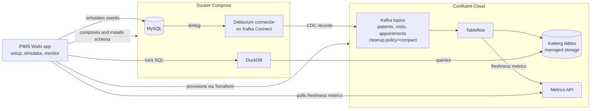
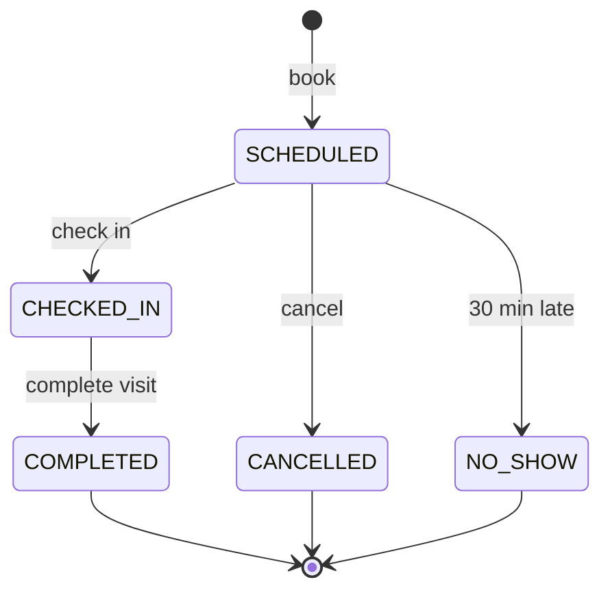

# PIMS
> Patient Information Management System

## Overview

PIMS is a self-contained demonstration of analytics on operational data. It
shows a MySQL database behind a patient information system being replicated,
as it changes, into Iceberg tables with Confluent Cloud Tableflow, and how
fresh those tables are while it happens.

The demo is designed so that the operator brings almost nothing:

- **No source system.** PIMS runs its own MySQL database and fills it with a
  simulated clinic, so there is no data to load and nothing to connect to.
- **No infrastructure to prepare.** One desktop app (Wails, Go and React)
  provisions Confluent Cloud, starts the local services, installs the schema,
  configures CDC and turns Tableflow on, in the right order, from a single
  Setup action. Setup is idempotent: after a failure or a relaunch it resumes
  where things are.
- **No tools to install.** Terraform is embedded and its binary is fetched on
  demand, and every local service runs in Docker.
- **No storage to arrange.** Tableflow uses Confluent managed storage, so the
  operator needs no object store, bucket or cloud account beyond Confluent
  Cloud.
- **No dashboards to build.** Freshness charts and a SQL window are part of the
  app.

### What the operator provides

| Input | Used for |
|---|---|
| Docker | Running MySQL, Kafka Connect and DuckDB locally |
| Confluent Cloud API key and secret | Provisioning, and reading the Metrics API |
| AWS region | Where the Kafka cluster and Tableflow storage are created |

The operator enters the key, secret and region when the app launches. They
are held in memory only, so after a relaunch they are entered again. Teardown
removes everything PIMS created: the connector, the containers and the MySQL
volume, and every Confluent Cloud resource.

### Architecture

The data path is `MySQL → Debezium → Kafka topics → Tableflow → Iceberg`.
Records are Avro with schemas in Schema Registry, keyed by each table's
primary key. Topics are compacted and every table has a primary key because
Tableflow's native Debezium support needs both: it keeps each table in upsert
mode, one row per key, so an update in MySQL changes a row in Iceberg and does
not add a second one. There is no Flink or other unwrap step in between.

## Components

PIMS is spread over three places: services in Docker on the operator's
machine, resources in Confluent Cloud, and the app itself, which runs the
simulation and the observability.

### Local services (Docker Compose)

An embedded compose project is rendered into the app's workspace and run with
the `docker compose` CLI under the project name `pims`. Published ports are
bound to `127.0.0.1`, and secrets reach the containers through the process
environment, never a file.

| Service | What it is | Role |
|---|---|---|
| `mysql` | MySQL 8.4, row-based binlog with full row images and GTIDs, server time zone UTC | The system of record. Holds the `patients`, `visits` and `appointments` tables, installed by PIMS once the service is healthy. |
| `connect` | Confluent Kafka Connect with the Debezium MySQL plugin | Runs the Debezium connector that reads the binlog and produces to Confluent Cloud. Connect's own state topics and the connector's schema history live in Confluent Cloud. |
| `duckdb` | An idle container with the DuckDB CLI | Where the SQL window runs queries over the Iceberg tables. It is started next to the others and used on demand. |

Debezium state is scoped to a MySQL "generation". Recreating the MySQL volume
gives a new connector name and schema-history topic, so offsets from an earlier
database are never reused.

### Confluent Cloud

Terraform, run in process through `terraform-exec`, provisions everything in
one environment dedicated to the demo. It runs in two phases.

| Resource | Notes |
|---|---|
| Environment | Named `pims-<suffix>`. Stream Governance Essentials, which provides Schema Registry |
| Kafka cluster | Named `pims-<suffix>`. Standard, single zone, on AWS in the chosen region |
| Topics | `patients`, `visits` and `appointments`, with `cleanup.policy=compact` |
| Service account | Named `pims-<suffix>-<environment id>`. Holds an environment-scoped `EnvironmentAdmin` role and nothing wider |
| API keys | One each for Kafka, Schema Registry and Tableflow, owned by the service account |
| Tableflow | Enabled on each topic as an Iceberg table in managed storage |

`<suffix>` is six random hex characters, generated the first time the app sets
up Confluent Cloud and saved as `suffix` in `settings.json` in the workspace.
Environment and service account names are unique within a Confluent Cloud
organisation, so the suffix lets several operators run the demo in one account
without colliding. It is kept across launches and after teardown, and is the
only setting besides the AWS region that the app saves. Everything else the
demo creates lives inside the operator's own environment and needs no suffix.

**Phase 1** creates everything except Tableflow. **Phase 2** enables Tableflow.
They are separate because Tableflow cannot be enabled on a topic that has no
schema, and Debezium registers a topic's schema only when it produces the
topic's first record. Setup therefore starts CDC and the simulator, waits for
the `<topic>-value` subjects to appear, and only then runs phase 2. Once
enabled, Tableflow stays on, and changing the AWS region on existing state is
refused.

The Metrics API is not provisioned. It is a Confluent Cloud service that the
app reads, using the operator's own Cloud API key.

### The PIMS app

The app is the control plane and also hosts the two long-running behaviours.

- **Setup** runs these steps in order, reporting each to the UI:
  1. Check Docker.
  2. Provision Confluent Cloud (phase 1).
  3. Start MySQL, Kafka Connect and DuckDB.
  4. Install the MySQL schema.
  5. Start the Debezium connector.
  6. Start the simulator.
  7. Wait for the topic schemas.
  8. Enable Tableflow (phase 2).
  9. Start the Tableflow metrics monitor.
- **Simulator** writes the clinic's events to MySQL. See [Simulation](#simulation).
- **Monitor** polls Tableflow's freshness metrics. See [Observability](#observability).
- **Secrets** are handled narrowly. Confluent Cloud credentials reach Terraform
  only through its process environment. Connector configs reference secrets as
  `${env:…}`, so they are never posted to, or returned by, the Connect REST
  API. Credential values redact themselves when logged or serialised.

## Simulation

The simulator plays a busy outpatient clinic: patients register, book,
cancel, turn up, miss appointments, walk in and are discharged. Its purpose is
to produce a steady, believable stream of inserts and updates across all three
tables, so there is always something for Tableflow to replicate.

### Operator control

The simulator starts during setup at 2 events per second. The operator can
change the rate while it runs, between 0.2 and 200 events per second, and stop
and start it. Each event is one write, or one transaction when it touches two
tables, against MySQL.

### Events

Each tick the simulator chooses one event. Weights depend on the state of the
clinic, so work that has become due is handled promptly and registrations
dominate while there are few patients (fewer than 25).

| Event | Table writes | When it is possible |
|---|---|---|
| Register patient | insert `patients` | Always |
| Update patient contact | update `patients` | A patient exists |
| Book appointment | insert `appointments` | A patient exists |
| Check in | insert `visits`, update appointment to `CHECKED_IN` | An appointment is due |
| Walk in | insert `visits` (`WALK_IN`, or `EMERGENCY` one time in five) | A patient exists and the clinic is open |
| Complete visit | update `visits`, update appointment to `COMPLETED` | A visit has run its course |
| No-show | update appointment to `NO_SHOW` | An appointment is over 30 minutes late |
| Cancel appointment | update appointment to `CANCELLED` | A future appointment exists |

An appointment moves through `SCHEDULED`, then `CHECKED_IN`, then `COMPLETED`,
or ends early as `CANCELLED` or `NO_SHOW`. Check-in and completion change the
visit and its appointment in a single database transaction, so the two stay
consistent in MySQL and arrive together in the change stream.

Because rows are updated as well as inserted, the topics carry several records
per key and the Iceberg tables are kept to the latest one, which is the
behaviour Tableflow's upsert mode exists for.

### The clinic clock

Business times come from a simulated clinic clock, not the wall clock. The
clock advances two minutes for each event and the clinic is open 08:00 to
17:00 UTC on weekdays. Nights and weekends are skipped. At typical rates a
simulated day passes in a few minutes, so booked appointments soon fall due
and the whole lifecycle plays out within a demo.

Appointments are booked up to two weeks ahead, favouring the next few days as
real clinics do, on 15-minute slots that finish before closing time. Timestamps
are kept apart on purpose. `scheduled_at` and `check_in_at` are clinic time,
while every table's `created_at` and `updated_at` are `DATETIME(3)` set by
MySQL in UTC when the row is written.

### Realism and domain rules

Data comes from a seeded generator, so a run is reproducible. Patients get
names, dates of birth, contact details and sequential medical record numbers.
Nine providers across general practice, paediatrics, cardiology, dermatology,
orthopaedics and immunisation take appointments, each with department-specific
reasons and durations. A separate emergency provider sees emergency walk-ins,
and completed visits record an ICD-10 diagnosis code.

The simulator keeps its own in-memory model of the clinic and enforces these
rules before it writes anything:

- A patient has at most one appointment on a given day.
- A provider is never double booked, and a longer appointment holds every slot
  it covers.
- Appointments start and finish inside clinic hours, on a business day.
- A visit for an appointment starts only when the appointment is due, and a
  patient is in at most one visit at a time.
- A no-show is an appointment that is over 30 minutes late.

The unique keys in the MySQL schema repeat the first two rules as a backstop.
If a write still collides, the simulator counts a conflict, drops the stale
appointment from its model and carries on.

### Resuming and failing

When the simulator starts it reads the database to rebuild its model: patients,
booked slots, appointments awaiting check-in, open visits and the highest
medical record number. The clock starts at the later of now and the latest
business time already recorded, so it never runs backwards across restarts and
a relaunched app carries on from the data that is there. If the database keeps
failing, for example because MySQL was stopped, the simulator stops after 20
consecutive errors instead of spinning.

## Observability

PIMS gives the operator two views of the pipeline. The **freshness charts**
show how far behind the Iceberg tables are, using Tableflow's own metrics. The
**SQL window** shows what is in them. Alongside these, the **Logs** panel
records every step and poll, the setup steps show progress, and the **Data
flow** diagram animates while the simulator runs.

### Freshness

PIMS does not measure latency itself. Tableflow reports two gauges per table
to the Confluent Cloud Metrics API, and PIMS charts them.

| Metric | What it is |
|---|---|
| `io.confluent.tableflow/event_freshness_latency_milliseconds` | The age of the newest record Tableflow has written to the table: from the record's timestamp to when Tableflow wrote it. It includes everything before Tableflow (the MySQL write, Debezium capture and Kafka). |
| `io.confluent.tableflow/processing_freshness_latency_milliseconds` | Tableflow's own processing time: from picking a record up to writing it to the table. |

The difference between the two is roughly the time spent before Tableflow, which
is what to read when asking whether a delay is in the CDC path or in Tableflow.

#### How PIMS polls

Once Tableflow is enabled, a monitor sends two queries every 60 seconds to
`POST https://api.telemetry.confluent.cloud/v2/metrics/cloud/query`, one per
metric, filtered to the demo's Kafka cluster (`resource.kafka.id`) and grouped
by `metric.topic`. Each asks for the last 5 hours at one-minute granularity
(`PT1M`), which is the longest window the API allows at that granularity, so a
poll returns up to 360 values per table per metric.

- The result replaces the previous one, so the charts always show the last 5
  hours. PIMS keeps nothing older. Going further back would need a coarser
  granularity or PIMS storing its own history.
- A poll that fails keeps the last good reading on screen and shows the error
  above it. It is not retried within the minute. The next poll reads the whole
  window again, so nothing is lost.
- Each poll logs a `Queried Tableflow freshness metrics` line with how many
  samples came back for each metric, the time of the newest, and any topics in
  the answer that PIMS does not chart (`other_topics`). If a chart stays empty,
  that line tells apart "the API returned nothing for this window" from "it
  returned rows PIMS could not match to a table".

#### Credentials

The query uses the operator's Cloud API key, over HTTPS, passed to the monitor
in memory and never logged. The Metrics API rejects keys scoped to a Kafka
cluster, and a `401` or `403` is shown in the panel with a hint. PIMS creates
no extra key for this. The demo's service account has no Metrics API access on
purpose, because the role that grants it is organisation-scoped and would widen
the account beyond the demo environment.

#### Reading the charts

- Both metrics are in **Preview** and can change before general availability.
- Tableflow updates the gauges when it commits to a table, so each table's value
  moves in steps and repeats between commits. Each point is the highest value
  Tableflow reported for that table in that minute.
- The Metrics API makes data available about three minutes after it is
  produced, and the first values can take several minutes to appear after
  Tableflow is enabled. Until then the charts say they are waiting.
- The charts do not read the Iceberg tables. The SQL window does.

### Querying the Tableflow tables

The **SQL** window runs the operator's own DuckDB SQL in the `duckdb`
container, so the replicated data can be inspected and compared with MySQL.
Once Tableflow is enabled, PIMS attaches its Iceberg REST catalog as
`tableflow`, so the tables are `tableflow."<kafka cluster id>".patients`,
`.appointments` and `.visits`. The window shows the exact names and starts the
operator off with a query for one of them. `DESCRIBE` shows a table's columns.

A **Tables** helper beside the editor lists each MySQL table's columns with
their types, keys and allowed values, and inserts names into the query at the
cursor. It describes the MySQL tables, so `DESCRIBE` is the way to see the
Iceberg tables' own types.

How it behaves:

- Each run is a fresh DuckDB session. The catalog is attached again, which takes
  a couple of seconds, and nothing a run creates is there for the next one.
- Several statements can run at once. The result of the last one that returned
  rows is shown, and the run stops at the first error.
- A result shows its first 1,000 rows and says how many there were in all.
  Output over 8 MiB is refused.
- A run is cut off after 5 minutes, inside the container too, so a runaway query
  does not keep using it. DuckDB may use 2 GB of memory and spills to disk
  beyond that. One query runs at a time.
- **Reading a Tableflow table is slow on a high-latency network.** DuckDB reads
  every manifest of a table before any data, even under a `LIMIT`, and each file
  is a separate request to S3. A table with about 130 manifests and 390 data
  files took 3 minutes over a 320 ms link, and takes a few seconds on a fast
  one. `DESCRIBE` reads only the table's metadata and takes seconds.
- Only SQL is accepted. A line starting with `.`, which the DuckDB shell takes
  as one of its own commands, is rejected.
- The session has the demo's Tableflow API key loaded in order to read the
  catalog, so the SQL is trusted input from the operator. Do not run SQL you do
  not trust.
- The Tableflow credentials come from the setup run, so after relaunching PIMS,
  run setup again before querying. It resumes where things are.
