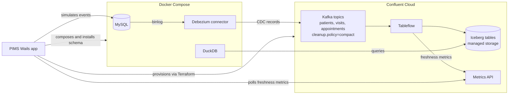

# PIMS
> Patient Information Management System

## Overview

This is a demo app to showcase how to use Confluent Cloud (CC) Tableflow and Debezium connector to materialize a set of tables from MySQL database.

## Components

- MySQL database with tables to store patients, visits and appointments
- Confluent Cloud Kafka Cluster with topics to store patients, visits and appointments
- Debezium connector to send CDC data from MySQL to respective topics in Kafka
- DuckDB for querying replicated data from Iceberg table

## Architecture

## Application
PIMS is a Wails Go app to:
- Fully automate the setup of each component
- Simulate patient registrations, visits and appointments in a realistic manner
- Visualise how fresh the replicated tables are, using Tableflow's freshness metrics.

## Prerequisites

- Docker

### Component Setup

PIMS automates the setup and configuration of all infrastructure components required to run the demo.

- Deploy Confluent Cloud Environment, Standard Kafka Cluster and required topics using Terraform. Ensure that Kafka topics' clean-up policy is set to `compact`. This is a prerequisite to use Tableflow with Debezium input. Use terraform exec library so that the operator does not have to install terraform separately.
    - When launched, prompt the user to enter AWS region, CC API key and secret that can be used to provision these resources.
    - Tableflow can be configured with Confluent managed storage

- Docker compose the following services. 
    - MySQL 
    - Debezium connector
    - DuckDB

- Once Confluent Cloud and Docker Compose services are running, install the schema in MySQL database.

### Simulation

Once the components are setup, simulate patient registrations, visits and appointments.
- Operator can control how many of those events/sec are simulated.
- Ensure the events resemble the real-world scenario. For example, a patient cannot have more than one appointment on the same day. 
- Database tables must include timestamps for create/update operations.

### Freshness visualisation
- Read Tableflow's freshness metrics from the Confluent Cloud Metrics API (`POST /v2/metrics/cloud/query`, authenticated with the operator's Cloud API key) and present them per table:
    - `io.confluent.tableflow/event_freshness_latency_milliseconds`: the age of the newest record written to the table, from the record's timestamp to when Tableflow wrote it.
    - `io.confluent.tableflow/processing_freshness_latency_milliseconds`: Tableflow's processing time, from picking a record up to writing it.
- Poll once a minute for the last 5 hours (the most the API allows at one-minute granularity), and show the latest value and a line graph for each metric.
- Say that the metrics are in Preview, that Tableflow only updates them when it commits, and that data reaches the API a few minutes late.
- PIMS does not derive latency from the data. The freshness charts do not use the DuckDB container.

### SQL query window
- Show a SQL editor with syntax highlighting where the operator can write a DuckDB query.
- Run it in the DuckDB container, with the Tableflow Iceberg REST catalog attached as `tableflow` once Tableflow is enabled, and show the result as a table with its row count and how long it took.
- Run only the selected text when there is a selection. Run with Cmd/Ctrl+Enter.
- Bound a run: cap the rows shown and the output read, and stop the query in the container after a timeout.
- Accept only SQL, not the DuckDB shell's own commands.

