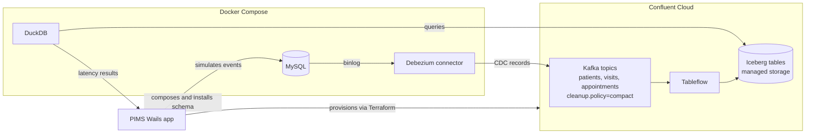

# PIMS
> Patient Information Management System

## Overview

This is a demo app to showcase how to use Confluent Cloud (CC) Tableflow and Debezium connector to materialize a set of tables from MySQL database.

## Components

- MySQL database with tables to store patients, visits and appointments
- Confluent Cloud Kafka Cluster with topics to store patients, visits and appointments
- Debezium connector to send CDC data from MySQL to respective topics in Kafka
- DuckDB for querying replicated data from Iceberg table

## Architecture

## Application
PIMS is a Wails Go app to:
- Fully automate the setup of each component
- Simulate patient registrations, visits and appointments in a realistic manner
- Visualise the end-to-end latency of the replication process.

## Prerequisites

- Docker

### Component Setup

PIMS automates the setup and configuration of all infrastructure components required to run the demo.

- Deploy Confluent Cloud Environment, Standard Kafka Cluster and required topics using Terraform. Ensure that Kafka topics' clean-up policy is set to `compact`. This is a prerequisite to use Tableflow with Debezium input. Use terraform exec library so that the operator does not have to install terraform separately.
    - When launched, prompt the user to enter AWS region, CC API key and secret that can be used to provision these resources.
    - Tableflow can be configured with Confluent managed storage

- Docker compose the following services. 
    - MySQL 
    - Debezium connector
    - DuckDB

- Once Confluent Cloud and Docker Compose services are running, install the schema in MySQL database.

### Simulation

Once the components are setup, simulate patient registrations, visits and appointments.
- Operator can control how many of those events/sec are simulated.
- Ensure the events resemble the real-world scenario. For example, a patient cannot have more than one appointment on the same day. 
- Database tables must include timestamps for create/update operations so that the end-to-end latency can be measured. 

### End to end visualisation
- Run a DuckDB query to retrive the latest records and visualise its source S3 file's timestamp. Visualise the gap in a line graph.

